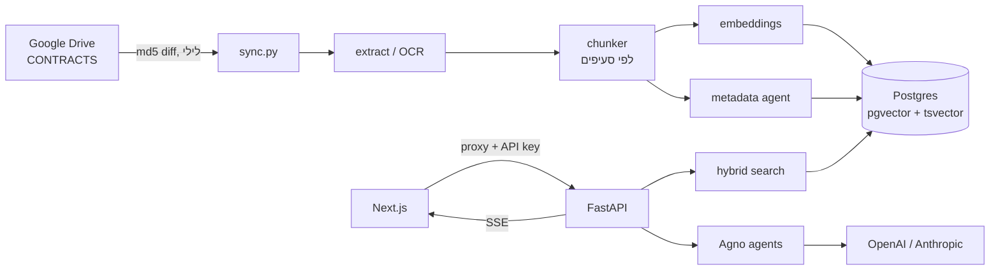

# מערכת חוזים והתחייבויות: תקציר טכני

תקציר למפתחים שמצטרפים לפרויקט. הוא מתאר את מבנה המערכת, את הזרימות המרכזיות, איפה כל דבר נמצא בקוד, ומה עוד חסר.

## במשפט אחד

המערכת היא RAG על חוזים וכתבי התחייבות בעברית. מסמכים מתיקיית Google Drive נקלטים בלילה: הטקסט מחולץ, סריקות עוברות OCR, המסמך מחולק לסעיפים ונשמר עם embeddings ב-Postgres+pgvector. FastAPI מתאם בקוד צוות של סוכני Agno שעונים עם ציטוטים ומנסחים הסכמים חדשים. הממשק בנוי ב-Next.js, בעברית ובכיוון RTL.

## Stack

| שכבה | טכנולוגיה |
|---|---|
| Backend | Python 3.11, FastAPI 0.156, SQLAlchemy 2.1 (sync, psycopg 3), Pydantic 2 |
| סוכנים | Agno 3.1.8. ספק LLM: OpenAI כברירת מחדל, Anthropic אוטומטית אם יש מפתח |
| מאגר | Postgres 16+ עם pgvector (HNSW, cosine) ו-tsvector (`simple`) |
| Embeddings | OpenAI `text-embedding-3-large` ב-1536 ממדים |
| חילוץ ו-OCR | PyMuPDF, python-docx, Tesseract (`heb+eng`), ו-vision LLM כגיבוי לעמוד בודד |
| Frontend | Next.js 15.5 (App Router), React 19, Tailwind 4, react-markdown |
| פריסה | Render (API ב-Docker, Web ב-Node), Neon (DB), GitHub Actions (סנכרון לילי) |

היקף הקוד: כ-6,300 שורות ב-Python וב-TypeScript.

## מבנה הריפו

```
backend/
  app/
    core/        config.py (כל ה-env), llm.py (שכבות מודלים, עלות, תקציב), tokens.py
    db/          models.py (כל הטבלאות), session.py (engine, init_db, kb_version)
    drive/       client.py (service account, listing רקורסיבי, הורדה ו-export)
    ingestion/   extract.py, ocr.py, normalize.py, chunker.py, pipeline.py
    rag/         embeddings.py, search.py (חיפוש היברידי)
    agents/      prompts.py, schemas.py, team.py (הגדרת הסוכנים)
    services/    chat.py, drafting.py, draft_format.py, docx_builder.py, sync.py
    api/         routes.py, deps.py (API key, SSE)
    jobs/        sync.py (cron / Actions), import_local.py
  tests/         test_core.py (unit, בלי DB ובלי רשת)
  samples/       3 הסכמי דוגמה בטקסט, לבדיקות מקומיות
  Dockerfile     כולל tesseract-ocr-heb
frontend/
  src/app/(app)/ המסכים: chat, contracts, draft, drafts, sync, usage
  src/app/api/[...path]/route.ts   proxy ל-backend שמוסיף את ה-API key בצד השרת
  src/middleware.ts                שער סיסמה
  src/lib/       api.ts (fetch ו-SSE), draftFormat.ts (parser, מראה של draft_format.py)
  src/components/ Shell, Answer, SourceNotes, ContractSheet, ui
render.yaml          פריסה חינמית (Render ו-Neon)
render.paid.yaml     פריסה בתשלום, הכול ב-Render כולל DB ו-cron
.github/workflows/nightly-sync.yml
docker-compose.yml   Postgres+pgvector לפיתוח מקומי
```

## ארכיטקטורה



**עיקרון מנחה:** התיאום בין הסוכנים כתוב ב-Python דטרמיניסטי (`services/`) ולא בסוכן coordinator. כך לא משלמים טוקנים על החלטות ניתוב, והזרימה צפויה וקלה לבדיקה. הסוכנים עצמם עושים רק את עבודת השפה.

## מודל הנתונים (`db/models.py`)

| טבלה | תפקיד |
|---|---|
| `documents` | קובץ אחד מ-Drive: מטא-דאטה של Drive, `md5`, `text_hash`, `status`, `ocr_pages`, `low_confidence_pages`, ושדות שחולצו (`contract_type`, `parties`, `amounts`, `summary`, `key_terms`...) |
| `chunks` | סעיף: `content`, `clause_number`, `clause_title`, `page_from/to`, `content_hash`, `embedding vector(1536)`, `tsv` (עמודה מחושבת). אינדקסים: HNSW ו-GIN |
| `sync_runs` | היסטוריית סנכרון עם ספירות, `items` ועלות |
| `token_usage` | שורה לכל קריאת LLM או embeddings: סוכן, מודל, טוקנים, `cached`, עלות משוערת |
| `answer_cache` | תשובות שמורות. המפתח: `sha256(שאלה מנורמלת, kb_version, פילטרים)` |
| `conversations`, `messages` | היסטוריית צ'אט, כולל `sources` לכל תשובה |
| `drafts` | טיוטות: הבקשה, התוכן (`ContractDraft`), הבדיקה, המקורות והעלות |
| `app_state` | `kb_version`, שעולה בכל שינוי במאגר ומבטל את המטמון בלי לסרוק אותו |

**סכמה:** `init_db()` מריץ `CREATE EXTENSION vector` ואחריו `create_all` בכל עלייה. עדיין אין Alembic (ראו "פערים ידועים").

## קליטת מסמכים (`ingestion/`)

1. **חילוץ** (`extract.py`):
   - **PDF:** שכבת הטקסט של PyMuPDF. עמוד עם פחות מ-40 תווים אלפא-נומריים נחשב סרוק, ורק הוא עובר OCR.
   - **DOCX:** פסקאות וטבלאות, עם עימוד משוער של 3,000 תווים לעמוד.
   - **תמונות:** כולל TIFF רב-עמודי.
   - **Google Docs:** מיוצאים כ-DOCX.
2. **OCR** (`ocr.py`), מהזול ליקר:
   1. Tesseract `heb+eng`, עם ממוצע ביטחון לכל מילה.
   2. אם הביטחון נמוך מ-60 או שאין Tesseract: vision LLM בשכבת `fast`, לעמוד הבודד בלבד.
3. **נרמול** (`normalize.py`):
   - הסרת ניקוד, תווי bidi ו-BOM; איחוד גרשיים ומקפים.
   - **זיהוי עברית הפוכה:** PDF שנשמר בסדר ויזואלי מזוהה לפי היוריסטיקה של אותיות סופיות בתחילת מילה, ומתוקן.
4. **חלוקה לסעיפים** (`chunker.py`):
   - כותרות ממוספרות (`1.`, `1.2`, `סעיף 4`) בעומק 2 לכל היותר. תתי-סעיפים כמו `(א)` נשארים בתוך ההורה.
   - שורה קצרה בלי מספר, מיד לפני סעיף, נלקחת ככותרת שלו.
   - מיזוג סעיפים של פחות מ-80 טוקנים, ופיצול מעל `MAX_CHUNK_TOKENS=700`.
   - הקטע שלפני הסעיף הראשון נשמר כ"מבוא וצדדים".
5. **מטא-דאטה:** קריאה אחת לסוכן `metadata` (שכבת `fast`, `output_schema=DocumentMetadata`), על כ-2,200 הטוקנים הראשונים ו-2,500 התווים האחרונים של המסמך.
6. **Embeddings:**
   - כל טקסט מקבל prefix של `כותרת המסמך | כותרת הסעיף`, כדי שגם סעיפים קצרים יקבלו הקשר.
   - batch של 96, עם retry.
   - **שימוש חוזר:** סעיף שה-`content_hash` שלו לא השתנה שומר את ה-embedding הקיים.
   - אם `text_hash` של המסמך כולו לא השתנה, הקליטה מדלגת עליו לגמרי.

## חיפוש (`rag/search.py`)

- **היברידי ב-SQL אחד:**
  - top-24 וקטורי (`<=>` cosine).
  - top-24 לפי מילים: `to_tsquery('simple')` עם `term:*` ו-OR בין המונחים.
  - איחוד בשיטת **RRF** עם `k=60`.
- **מונחי חיפוש בעברית:** כל מילה נשלחת גם בלי אות שימוש בתחילתה (ו, ה, ב, ל, מ, ש, כ), ומילות עצירה מסוננות.
- **מגבלה לכל מסמך:** 3 סעיפים לכל היותר (6 כשהחיפוש מוגבל למסמך אחד), ו-`top_k=6` בסך הכל.
- **סף רלוונטיות:** `max(similarity) < 0.30` נחשב "לא נמצא". במקרה כזה הצ'אט שולח רק 2 קטעים ומפעיל חיפוש באינטרנט.
- **פורמט ההקשר:** `<excerpts>` ממוספרים `[n]`, והמודל מצטט `[n]` במקום לחזור על שמות המסמכים.

## הסוכנים (`agents/team.py`)

| סוכן | שכבה | פלט | הערות |
|---|---|---|---|
| `metadata` | fast | `DocumentMetadata` | חילוץ נתוני המסמך בזמן הקליטה |
| `router` | fast | `RouteDecision` | רץ **רק כשיש היסטוריה**. כשאין, הניתוב נעשה לפי היוריסטיקות |
| `librarian` | main | טקסט ב-stream | עונה רק מתוך `<excerpts>`/`<web>`, ומצטט `[n]` או `[wN]` |
| `web_researcher` | fast | טקסט | Tavily אם יש מפתח, אחרת DuckDuckGo. `tool_call_limit=2`, 5 תוצאות |
| `drafter` | draft | טקסט ב-stream (פורמט שורות) | מעדיף נוסח מ-excerpts, ומסמן כל סעיף `[מקור N]`, `[חדש]` או `[אינטרנט]` |
| `reviewer` | main, או review כשמבקשים `deep_review` | `Review` | 8 הערות לכל היותר, עם severity |
| `reviser` | main | פורמט שורות | מחזיר **רק פרקים שתוקנו** (patch) |

**שכבות המודלים** מוגדרות ב-`config.py` וניתנות לשינוי ב-env:

| שכבה | OpenAI | Anthropic |
|---|---|---|
| `fast` | `gpt-4.1-mini` | `claude-haiku-5-5` |
| `main` | `gpt-4.1` | `claude-sonnet-5-5` |
| `draft` | `gpt-5.5` | `claude-sonnet-5-5` |
| `review` | `gpt-5.5` | `claude-opus-5-5` |

במודלי reasoning הקוד לא שולח `temperature`, וקובע `max_completion_tokens` גבוה עם `reasoning_effort` נמוך (או בינוני ב-review).

**Prompts:** כל ה-system prompts סטטיים וקצרים, כדי ש-prompt caching יעבוד (אוטומטי ב-OpenAI, `cache_system_prompt` ב-Claude). כל הנתונים המשתנים נכנסים להודעת המשתמש, עטופים בתגיות, עם הנחיה מפורשת להתייחס לתוכן שבתגיות כמידע ולא כהוראות. זו ההגנה מפני prompt injection מתוך מסמכים ודפי אינטרנט.

## זרימת הצ'אט (`services/chat.py`)

```
POST /api/chat  →  SSE
conversation → status → sources → [status:web → sources] → delta* → done | error | action
```

1. **ניתוב:**
   - בלי היסטוריה: היוריסטיקות בלבד (draft, compare, needs_web).
   - עם היסטוריה: `router` משכתב את השאלה לשאלה עצמאית.
2. **בקשה לנסח הסכם:** אירוע `action:open_draft`, בלי קריאה ל-LLM.
3. **מטמון:** נבדק רק בשאלה ראשונה בשיחה, כשאין צורך ב-web, והרשומה תקפה לפי `kb_version`.
4. **חיפוש:** המקורות נשלחים ל-UI **לפני** הקריאה למודל.
5. **web:** רק כשהשאלה מסומנת כ-`needs_web` או כשהחיפוש לא מצא סעיף רלוונטי.
6. **התשובה:** `librarian` ב-stream. השימוש נרשם, התשובה נשמרת, ונכנסת למטמון כשמותר.

תקציב: לפני כל שלב LLM הקוד קורא ל-`ensure_budget()`, שבודק סכום טוקנים מתגלגל של 24 שעות מול `DAILY_TOKEN_BUDGET`.

## זרימת הניסוח (`services/drafting.py`)

```
POST /api/drafts  →  SSE
draft → step(precedents) → [step(web)] → step(drafting) → draft_delta* → step(review) → [step(revise)] → done | error
```

- **פורמט שורות במקום JSON:** החוזה נכתב ב-stream בפורמט שורות ("כותרת:", "פרק N:", "1.1 [מקור 3] ..."). הפורמט מוצג חי ב-UI, וחוסך טוקנים לעומת JSON. `draft_format.py` ו-`draftFormat.ts` הם אותו parser בשתי השפות, ויש לשנות את שניהם יחד.
- **סדר העבודה:**
  1. הבודק קורא רנדור טקסט קומפקטי של הטיוטה.
  2. אם יש הערות `high`, ה-reviser מקבל רק את הפרקים שנפגעו.
  3. `apply_revision` ממזג לפי מספר פרק.
- **ייצוא:** `docx_builder.py` כותב DOCX עם `w:bidi` ו-`w:rtl`, גופן David, ושורת הסתייגות.

**מדדים (gpt-5.5, low effort):** הטקסט הראשון מגיע אחרי כ-6 עד 10 שניות, כל התהליך לוקח 75 עד 110 שניות, והעלות 4 עד 6 סנט לטיוטה.

## סנכרון (`services/sync.py`)

- **`plan_sync(remote, known)`:** פונקציה טהורה, ונבדקת ביחידה. היא מחזירה new, changed, unchanged, removed ו-unsupported.
- **fingerprint:** `md5Checksum`. ל-Google Docs אין md5, ולכן במקומו `mtime:<modifiedTime>`.
- **ניסיון חוזר:** מסמך במצב `failed` או לא פעיל נחשב "changed" ונקלט שוב בריצה הבאה.
- **removed:** soft delete, כלומר `is_active=false`. מסמכים עם prefix של `local:` מ-`import_local` לא נמחקים לעולם.
- **מניעת ריצה כפולה:** `pg_try_advisory_lock(784221001)`. ריצה שקרסה ונשארה במצב `running` נסגרת בתחילת הריצה הבאה.
- **בידוד כשלים:** כל קובץ רץ בטרנזקציה משלו, וכשל בקובץ אחד לא עוצר את שאר הריצה. בסוף, אם משהו השתנה, הריצה מעלה את `kb_version`.
- **הפעלה:**
  - `python -m app.jobs.sync nightly`, מ-GitHub Actions ב-23:00 UTC או מ-Render Cron בגרסה בתשלום.
  - `POST /api/sync` מריץ ב-thread בתוך תהליך ה-API, והמסך מושך את `GET /api/sync/status`.

## API

כל הנתיבים תחת `/api` מחייבים את הכותרת `X-API-Key` כש-`API_KEY` מוגדר. הנתיב `/health` פתוח.

| Method | Path |
|---|---|
| GET | `/overview`, `/documents?q&contract_type&status`, `/documents/{id}`, `/contract-types` |
| POST | `/documents/{id}/reindex` |
| POST (SSE) | `/chat` `{message, conversation_id?, contract_type?, document_id?}` |
| GET / DELETE | `/conversations`, `/conversations/{id}` |
| POST (SSE) | `/drafts` (`DraftRequest`) |
| GET / PUT / DELETE | `/drafts`, `/drafts/{id}`; GET `/drafts/{id}/docx` |
| POST / GET | `/sync`; `/sync/status`, `/sync/runs` |
| GET | `/usage?days=` |

## Frontend

- **Proxy:** `src/app/api/[...path]/route.ts` מעביר כל בקשה ל-`BACKEND_URL` ומוסיף את `BACKEND_API_KEY` בצד השרת. המפתח לא מגיע לדפדפן, ו-SSE עובר כ-stream.
- **שער הסיסמה (`middleware.ts`):**
  - cookie שמכיל `sha256(SESSION_SECRET:APP_PASSWORD)`.
  - **ב-production בלי `APP_PASSWORD` האתר ננעל** (מחזיר 503).
  - פטורים רק `emblem.png`, `icon.png`, `apple-icon.png` ו-`favicon.ico`.
- **SSE:** `lib/api.ts → stream()` קורא את התשובה ב-`fetch` ו-`ReadableStream`. זה מאפשר POST, ש-`EventSource` לא תומך בו.
- **עיצוב:** הטוקנים מוגדרים ב-`globals.css` (`--ink #1e2454`, `--lavender`, `--marker #ffe45c`). הגופנים: Frank Ruhl Libre לכותרות ול"גיליון" החוזה, ו-IBM Plex Sans Hebrew לממשק.
- **ציטוטים:** `Answer.tsx` הופך כל `[n]` לשבב highlighter, ו-`SourceNotes.tsx` מציג את המקורות בשוליים, בקישור דו-כיווני ב-hover.

## משתני סביבה עיקריים

**Backend.** ראו `.env.example`. ערכים עוברים ניקוי אוטומטי: whitespace, מירכאות, תווי bidi, שורות נוספות, ו-prefix בצורת `NAME=`.

| משתנה | תפקיד |
|---|---|
| `DATABASE_URL` | חיבור ל-DB. כתובות `postgres://` מומרות ל-psycopg. ב-Neon חובה חיבור **ישיר**, לא pooler, בגלל ה-advisory lock |
| `OPENAI_API_KEY` | חובה, גם בשביל embeddings |
| `ANTHROPIC_API_KEY` | אופציונלי. מעביר את הצ'אט והניסוח ל-Claude |
| `TAVILY_API_KEY` | אופציונלי, לחיפוש web |
| `GOOGLE_DRIVE_SERVICE_ACCOUNT_JSON` | נתיב לקובץ או JSON גולמי. ברירת המחדל: `/etc/secrets/service_account.json` ואחריו `service_account.json` |
| `GOOGLE_DRIVE_FOLDER_ID` / `GOOGLE_DRIVE_FOLDER_PATH` | התיקייה לסנכרון. אם אין ID, התיקייה מאותרת לפי הנתיב |
| `API_KEY`, `CORS_ORIGINS` | הגנה על ה-API |
| `DAILY_TOKEN_BUDGET`, `ANSWER_CACHE_ENABLED` | תקציב ומטמון |
| `RETRIEVAL_TOP_K`, `RETRIEVAL_MIN_SIMILARITY`, `MAX_CHUNK_TOKENS` | כיוונון החיפוש |
| `OPENAI_*_MODEL` / `ANTHROPIC_*_MODEL` | החלפת מודל בכל שכבה |

**Frontend:** `BACKEND_URL`, `BACKEND_API_KEY`, `APP_PASSWORD`, `SESSION_SECRET`.

## פיתוח מקומי ובדיקות

```bash
docker compose up -d db                       # pgvector על 5432
python -m venv .venv && .venv/Scripts/pip install -r backend/requirements.txt
cd backend && ../.venv/Scripts/python -m uvicorn app.main:app --port 8000
../.venv/Scripts/python -m app.jobs.import_local samples   # בלי Drive
../.venv/Scripts/python -m pytest -q                        # 19 בדיקות unit
cd ../frontend && npm install && npm run dev
```

הבדיקות מכסות נרמול, זיהוי עברית הפוכה, chunker, חילוץ PDF, `plan_sync`, ניתוב, מפתח המטמון, parser הטיוטות, `apply_revision`, ייצוא DOCX וניקוי סודות. אין בדיקות אינטגרציה מול DB או LLM.

## פערים ידועים והמשך מומלץ

1. **אין migrations:** `create_all` לא משנה טבלאות קיימות. לפני שינוי סכמה ראשון צריך להכניס Alembic.
2. **אין בדיקות אינטגרציה:** חסר כיסוי ל-`search()` מול pgvector אמיתי, ל-SSE ול-`sync` עם Drive מדומה. כדאי להוסיף ב-CI עם service container של pgvector.
3. **Golden set:** אין סט שאלות להערכת איכות. כדאי להוסיף כ-30 שאלות עם סעיף צפוי, ולמדוד Recall@6 ודיוק ציטוטים לפני כל שינוי ב-chunker, ב-embeddings או בפרומפטים.
4. **סנכרון ידני בתוך תהליך ה-API:** ב-Render חינמי התהליך עלול להירדם באמצע ריצה ארוכה. העדיפות היא לסנכרן דרך Actions.
5. **הרשאות:** סיסמה משותפת אחת, בלי משתמשים, תפקידים או audit לכל משתמש. לשימוש רחב צריך SSO.
6. **OCR:** בחלק מהסריקות סדר המילים בשמות צדדים יוצא הפוך. אפשר לשפר עם הגדרת `--psm` לפי עמוד, או vision רק לעמודי שער.
7. **מחירים:** טבלת `PRICES` ב-`llm.py` משוערת, ומחירי `gpt-5.5` הם הערכה. לכן מסך העלויות מציג מגמה ולא חיוב מדויק.
8. **פרטיות:** הריפו ציבורי, ומומלץ להפוך אותו לפרטי. בנוסף, קטעי מסמכים נשלחים ל-OpenAI, וזה דורש אישור של אבטחת מידע לפני הרחבה.
9. **Parser כפול:** `draft_format.py` ו-`draftFormat.ts` חייבים להישאר זהים. כדאי להוסיף בדיקה משותפת על אותם fixtures.
